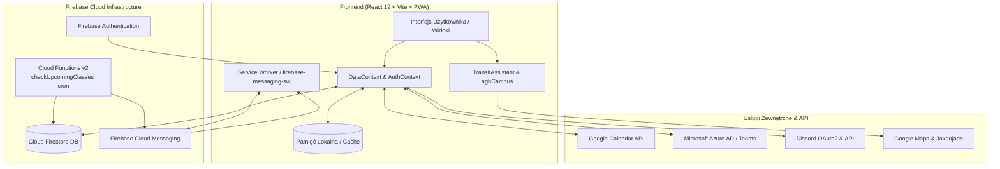
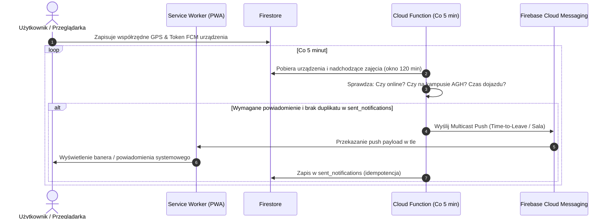

# 🎓 StudyOrganizer – Inteligentny Organizer Studencki (AGH)

Nowoczesny, zintegrowany asystent i organizer akademicki stworzony z myślą o studentach (ze szczególnym uwzględnieniem specyfiki **Akademii Górniczo-Hutniczej w Krakowie**). Aplikacja łączy synchronizację planu zajęć, asystenta dojazdów z geofencingiem kampusu, inteligentne powiadomienia *Time-to-Leave*, zarządzanie zadaniami oraz zintegrowany pulpit uczelniany (Teams, UPeL AGH, Discord).

---

## 📑 Spis Treści
1. [Przegląd Projektu & Główne Funkcjonalności](#-przegląd-projektu--główne-funkcjonalności)
2. [Architektura Systemu](#-architektura-systemu)
   - [Schemat Przepływu Danych](#schemat-przepływu-danych)
   - [Architektura Powiadomień i Time-to-Leave](#architektura-powiadomień-i-time-to-leave)
   - [Model Danych Firestore](#model-danych-firestore)
3. [Struktura Katalogów](#-struktura-katalogów)
4. [Główne Moduły i Komponenty](#-główne-moduły-i-komponenty)
5. [Instalacja i Uruchomienie Lokalne](#-instalacja-i-uruchomienie-lokalne)
6. [Konfiguracja Środowiska (.env)](#-konfiguracja-środowiska-env)
7. [Wdrożenie Produkcyjne (Firebase)](#-wdrożenie-produkcyjne-firebase)
8. [🚀 Jak Działać Dalej (Roadmapa Rozwoju)](#-jak-działać-dalej-roadmapa-rozwoju)

---

## 🌟 Przegląd Projektu & Główne Funkcjonalności

- **📅 Centralny Plan Zajęć**:
  - Automatyczna synchronizacja z **Google Calendar** w czasie rzeczywistym z obsługą automatycznego odświeżania tokenów OAuth.
  - Możliwość importu kalendarzy USOS iCal oraz ręcznego dodawania i nadpisywania sesji.
  - Filtry: widok dni roboczych (5 dni) lub pełnego tygodnia (7 dni), podział na wydarzenia akademickie i prywatne, filtrowanie per przedmiot.
- **🏛️ Silnik Kampusu AGH (`aghCampus.js`)**:
  - Inteligentne parsowanie sal i budynków z opisów USOS/GCal (np. `B-9, Sala: 012`, `D-17 s. 1.19`, `C-2 s. 429`, `Centrum Energetyki C-5`, `A-0` jako zajęcia zdalne).
  - Geofencing kampusu (promień 650 m wokół centrum AGH) oraz poszczególnych pawilonów.
  - Bezpośrednie odnośniki do nawigacji Google Maps i wejść do budynków.
- **🚌 Asystent Dojazdów i Komunikacji Miejskiej (`TransitAssistant`)**:
  - Kalkulator czasu wyjścia (*Time-to-Leave*) na zajęcia na podstawie lokalizacji GPS lub predefiniowanego adresu domowego (np. Mogilska).
  - Dynamiczny wybór środka transportu: tramwaj/autobus (MPK Kraków), spacer, rower.
  - Generowanie głębokich linków nawigacyjnych do **Jakdojade** oraz **Google Maps**.
- **🔔 Hybrydowy System Powiadomień**:
  - **Lokalne (Foreground / Service Worker)**: Natychmiastowe alerty w przeglądarce i PWA o zbliżających się zajęciach.
  - **Zdalne (Background Cloud Functions + FCM)**: Cykliczny harmonogram w chmurze (co 5 minut) weryfikujący położenie użytkownika i wysyłający powiadomienia push:
    - Gdy użytkownik jest poza kampusem: alert *"Czas wyjść na zajęcia za X min"*.
    - Gdy użytkownik jest już na kampusie: alert o sali i pawilonie 15 min przed zajęciami.
    - Gdy zajęcia są online: alert z bezpośrednim linkiem do spotkania na Teams 10 min wcześniej.
- **🪟 Panel Uczelniany – Okno w Oknie (`FloatingDashboardWindow`)**:
  - Pływający widget (Picture-in-Picture) dostępny z dowolnego widoku.
  - Szybkie przełączanie między **Microsoft Teams**, platformą e-learningową **UPeL AGH** oraz kanałami na **Discordzie**.
- **✅ Zadania i Projekty (`TasksView`)**:
  - Tablica zadań z priorytetami (Wysoki, Średni, Niski), terminami i bezpośrednim powiązaniem z przedmiotami uczelnianymi.
- **📥 Skrzynka Ogłoszeń i Wiadomości (`InboxView`)**:
  - Agregacja ważnych informacji z grup studenckich (Discord, Teams, maile starosty).

---

## 🏗️ Architektura Systemu

Aplikacja oparta jest na architekturze Serverless (Frontend SPA + Firebase BaaS + Cloud Functions v2).



### Schemat Przepływu Danych

1. **Uwierzytelnienie**: Użytkownik loguje się przez `GoogleAuthProvider` z zakresem uprawnień kalendarza (`https://www.googleapis.com/auth/calendar.readonly`).
2. **Synchronizacja Danych**:
   - `DataContext` nasłuchuje w czasie rzeczywistym kolekcji Firestore (`courses`, `sessions`, `tasks`, `messages`) poprzez `onSnapshot`.
   - Wydarzenia z Google Calendar są pobierane do pamięci lokalnej i scalane z ręcznymi sesjami oraz nadpisaniami (`sessionOverrides`).
3. **Detekcja Lokalizacji & Czasu Wyjścia**:
   - Moduł `aghCampus.js` analizuje ciąg znaków lokalizacji i wyciąga kod pawilonu (np. `D-17`).
   - `transit.js` oblicza estymowany czas podróży z punktu startowego do docelowych współrzędnych i wyznacza optymalną godzinę wyjścia.

### Architektura Powiadomień i Time-to-Leave



### Model Danych Firestore

Struktura bazy danych zabezpieczona regułami w [`web/firestore.rules`](file:///d:/Organizer/web/firestore.rules):

| Kolekcja / Ścieżka | Opis | Główne pola |
| :--- | :--- | :--- |
| `users/{userId}` | Profil użytkownika i preferencje | `email`, `displayName`, `lastLocation` `{lat, lng}`, `commuteSettings` |
| `users/{userId}/devices/{deviceId}` | Zarejestrowane urządzenia Push | `fcmToken`, `platform`, `userAgent`, `enabled`, `updatedAt` |
| `users/{userId}/sent_notifications/{alertId}` | Log wysłanych powiadomień | `sentAt`, `title`, `body` (ochrona przed spamem) |
| `tokens/{userId}` | Tokeny autoryzacyjne integracji | `googleCalendar`, `discord`, `microsoft`, `updatedAt` |
| `courses/{courseId}` | Przedmioty akademickie | `uid`, `name`, `color`, `type`, `upelUrl`, `upelWykUrl`, `upelLabUrl`, `teamsUrl`, `discordUrl` |
| `sessions/{sessionId}` | Zajęcia i wydarzenia | `uid`, `title`, `start`, `end`, `location`, `courseId`, `mode`, `category`, `teamsLink` |
| `tasks/{taskId}` | Zadania do wykonania | `uid`, `title`, `courseId`, `priority`, `dueDate`, `done`, `note` |
| `messages/{messageId}` | Wiadomości / Ogłoszenia | `uid`, `courseId`, `content`, `author`, `source`, `createdAt` |

---

## 📁 Struktura Katalogów

```
Organizer/
├── README.md                      # Główna dokumentacja projektu
└── web/                           # Kod źródłowy aplikacji webowej
    ├── functions/                 # Backend Firebase Cloud Functions (Node.js 20)
    │   ├── index.js               # checkUpcomingClasses (harmonogram co 5 min)
    │   ├── package.json           # Zależności Cloud Functions
    │   └── .env.local             # Zmienne środowiskowe funkcji
    ├── public/                    # Zasoby statyczne i pliki PWA
    │   ├── firebase-messaging-sw.js # Service Worker dla powiadomień w tle
    │   ├── manifest.json          # Manifest PWA (instalowalność na telefonie)
    │   └── favicon.svg, icons.svg
    ├── src/                       # Kod źródłowy React (Vite)
    │   ├── assets/                # Grafiki, logo, ikony
    │   ├── components/            # Komponenty UI wielokrotnego użytku
    │   │   ├── ClassCard.jsx      # Karta pojedynczych zajęć z etykietami typu
    │   │   ├── FloatingDashboardWindow.jsx # Okno w oknie (Teams, UPeL, Discord)
    │   │   ├── NotificationManager.jsx # Menadżer powiadomień lokalnych
    │   │   ├── TransitAssistant.jsx    # Widget asystenta dojazdu i Jakdojade
    │   │   ├── TeamsWidget.jsx    # Integracja z Microsoft Teams
    │   │   ├── UpelWidget.jsx     # Szybki dostęp do platformy UPeL AGH
    │   │   ├── DiscordWidget.jsx  # Integracja z serwerem Discord
    │   │   ├── WeekGridView.jsx   # Siatka widoku tygodniowego kalendarza
    │   │   └── Sidebar.jsx, MobileBottomNav.jsx
    │   ├── contexts/              # Zarządzanie stanem (Context API)
    │   │   ├── AuthContext.jsx    # Logowanie Google, OAuth Discord i Microsoft
    │   │   └── DataContext.jsx    # Centralny stan danych, cache i synchronizacja
    │   ├── services/              # Warstwa komunikacji z zewnętrznymi usługami
    │   │   ├── googleCalendar.js  # Pobieranie i mapowanie eventów z Google API
    │   │   ├── notificationService.js # Rejestracja FCM i Service Workera
    │   │   └── commuteService.js  # Logika obliczania dojazdów i geolokalizacji
    │   ├── utils/                 # Algorytmy i funkcje pomocnicze
    │   │   ├── aghCampus.js       # Baza współrzędnych i parser budynków AGH
    │   │   ├── courseMatcher.js   # Normalizacja nazw i mapowanie na przedmioty
    │   │   └── transit.js         # Obliczenia odległości (Haversine), linki Jakdojade
    │   ├── views/                 # Główne ekrany aplikacji
    │   │   ├── TodayView.jsx      # Panel dnia dzisiejszego (Next up, Asystent dojazdu)
    │   │   ├── CalendarView.jsx   # Widok kalendarza tygodniowego i miesięcznego
    │   │   ├── CourseView.jsx     # Karta przedmiotu (z podziałem na WYK, LAB, PROJ)
    │   │   ├── TasksView.jsx      # Lista zadań i projektów
    │   │   ├── InboxView.jsx      # Wiadomości i ogłoszenia
    │   │   └── SettingsView.jsx   # Ustawienia integracji, dojazdów i motywu
    │   ├── App.jsx                # Router i główny szkielet aplikacji
    │   └── firebase.js            # Inicjalizacja Firebase Client SDK
    ├── firestore.rules            # Produkcyjne reguły bezpieczeństwa Firestore
    ├── firebase.json              # Konfiguracja Firebase Hosting, Functions i Rules
    ├── package.json               # Zależności aplikacji frontendowej
    └── vite.config.js             # Konfiguracja bundlera Vite
```

---

## 🧩 Główne Moduły i Komponenty

1. **`aghCampus.js` (Baza Wiedzy AGH)**:
   - Zawiera szczegółowe metadane o 22 pawilonach AGH (m.in. D-17 Centrum Informatyki, C-2, C-3, B-9, C-5 Centrum Energetyki, A-0, U-2 Centrum Dydaktyki).
   - Przechowuje dokładne współrzędne GPS, najbliższe przystanki MPK (np. *Kawiory*, *Czarnowiejska*, *AGH / UR*), wskazówki dotyczące wejść i łączników między budynkami.
   - Posiada reguły rozpoznawania zajęć zdalnych (kodowanie USOS `A-0` lub słowa kluczowe `zdalnie`, `online`, `teams`).
2. **`TransitAssistant.jsx`**:
   - Wyświetla natychmiastowe odliczanie do wyjścia z domu.
   - Uwzględnia konfigurowalny bufor bezpieczeństwa (np. 5–10 min) oraz czas potrzebny na dojście z przystanku do konkretnej sali.
   - Oferuje przyciski uruchamiające wyszukiwanie połączeń w Jakdojade (z gotowymi współrzędnymi startu i celu) oraz nawigację pieszą/samochodową w Google Maps.
3. **`FloatingDashboardWindow.jsx`**:
   - Rozwiązuje problem konieczności ciągłego otwierania nowych kart przeglądarki podczas nauki.
   - Umożliwia pracę w trybie wielozadaniowym (pływające okno z możliwością minimalizacji, maksymalizacji i szybkiego kopiowania linków).

---

## 🛠️ Instalacja i Uruchomienie Lokalne

### Wymagania wstępne:
- **Node.js**: w wersji 20.x lub nowszej.
- **npm** lub **pnpm**.
- Zainstalowane narzędzie **Firebase CLI**:
  ```bash
  npm install -g firebase-tools
  ```

### Krok 1: Klonowanie i instalacja zależności
```bash
# Wejdź do katalogu aplikacji webowej
cd web

# Zainstaluj zależności frontendu
npm install

# Zainstaluj zależności Cloud Functions
cd functions
npm install
cd ..
```

### Krok 2: Uruchomienie deweloperskie frontendu
```bash
# Będąc w katalogu web:
npm run dev
```
Aplikacja uruchomi się pod adresem: `http://localhost:5173`.

### Krok 3: (Opcjonalnie) Uruchomienie emulatorów Firebase
Aby testować funkcje w tle i bazę danych bez wpływu na środowisko produkcyjne:
```bash
firebase emulators:start --only functions,firestore
```

---

## ⚙️ Konfiguracja Środowiska (.env)

W katalogu `web/` utwórz plik `.env` na podstawie wzorca `.env.example`:

```env
# Firebase Client SDK (pobrane z Firebase Console -> Project Settings)
VITE_FIREBASE_API_KEY=twoj_api_key
VITE_FIREBASE_AUTH_DOMAIN=twoj-projekt.firebaseapp.com
VITE_FIREBASE_PROJECT_ID=twoj-projekt
VITE_FIREBASE_STORAGE_BUCKET=twoj-projekt.appspot.com
VITE_FIREBASE_MESSAGING_SENDER_ID=twoj_sender_id
VITE_FIREBASE_APP_ID=twoj_app_id

# Klucz VAPID dla Web Push (Firebase Console -> Cloud Messaging -> Web Push certificates)
VITE_FIREBASE_VAPID_KEY=twoj_publiczny_klucz_vapid

# Discord OAuth2 (opcjonalnie do integracji z serwerem kierunkowym)
VITE_DISCORD_CLIENT_ID=twoj_discord_client_id

# Microsoft Azure AD (opcjonalnie do integracji z kontem uczelnianym Office 365 / Teams)
VITE_MICROSOFT_CLIENT_ID=twoj_azure_client_id
VITE_MICROSOFT_TENANT_ID=common
```

---

## 🚀 Wdrożenie Produkcyjne (Firebase)

Aplikacja jest w pełni przystosowana do wdrożenia na infrastrukturę Firebase (Hosting, Firestore, Functions):

```bash
# 1. Zaloguj się do Firebase CLI
firebase login

# 2. Wybierz swój projekt
firebase use twoj-id-projektu

# 3. Zbuduj frontend produkcyjny
npm run build

# 4. Wdróż reguły bezpieczeństwa Firestore
firebase deploy --only firestore:rules

# 5. Wdróż Cloud Functions (scheduler powiadomień)
firebase deploy --only functions

# 6. Wdróż frontend na Firebase Hosting
firebase deploy --only hosting

# LUB wdróż wszystko jednym poleceniem:
firebase deploy
```

---

## 🧭 Jak Działać Dalej (Roadmapa Rozwoju)

Poniżej znajduje się rekomendowana ścieżka dalszych prac nad projektem, podzielona według priorytetów:

### 1. Dokończenie Wdrożenia i Konfiguracji (Priorytet Wysoki 🔴)
- [ ] **Wdrożenie Cloud Functions**: Upewnij się, że projekt w Firebase Console ma włączony plan *Blaze* (wymóg Cloud Functions v2 w Google Cloud).
- [ ] **Wygenerowanie Certyfikatu VAPID**: Dodaj parę kluczy Web Push w Firebase Console i wklej klucz publiczny do `VITE_FIREBASE_VAPID_KEY` w `.env`.
- [ ] **Zainstalowanie PWA na telefonie**: Otwórz wdrożoną stronę na smartfonie (Chrome / Safari), wybierz opcję *"Dodaj do ekranu głównego"* i zezwól na powiadomienia, aby aktywować powiadomienia wibracyjne *Time-to-Leave*.

### 2. Integracje Automatyczne (Priorytet Średni 🟡)
- [ ] **Webhook / Bot Discord**:
  - Utworzenie prostego bota Discord na serwerze kierunku (Teleinformatyka), który nasłuchuje wyznaczonych kanałów z ogłoszeniami (np. `#ogłoszenia`, `#starosta`) i automatycznie zapisuje nowe posty do kolekcji `messages` w Firestore.
- [ ] **Integracja z API USOSweb AGH**:
  - Zastąpienie statycznego importu iCal bezpośrednią autoryzacją OAuth 1.0a do USOS API (automatyczne pobieranie planu, ocen oraz terminów kolokwiów).
- [ ] **Dynamiczne dane komunikacji miejskiej (Kraków TTSS / GTFS-RT)**:
  - Zintegrowanie otwartego API krakowskiego MPK/ZTP (pozycje tramwajów i autobusów w czasie rzeczywistym), aby kalkulator dojazdu uwzględniał rzeczywiste opóźnienia pojazdów, a nie tylko rozkład jazdy.

### 3. Udoskonalenia Funkcjonalne & UI (Priorytet Średni 🟡)
- [ ] **Załączniki i Notatki do Zajęć**:
  - Dodanie obsługi uploadu plików (Firebase Storage) bezpośrednio w widoku przedmiotu (`CourseView` -> zakładka *Pliki*): sprawozdania z laboratoriów, slajdy z wykładów.
- [ ] **Tryb Offline First**:
  - Rozszerzenie konfiguracji Service Workera o pełne buforowanie zasobów statycznych (Cache API), umożliwiające przeglądanie planu zajęć bez dostępu do Internetu (np. w salach w podziemiach budynków AGH).

### 4. Jakość i DevOps (Priorytet Długoterminowy 🟢)
- [ ] **Automatyzacja CI/CD (GitHub Actions)**:
  - Skonfigurowanie workflow budującego aplikację i uruchamiającego linter (`oxlint`) oraz automatyczny deploy na Firebase Hosting po pushu do gałęzi `main`.
- [ ] **Testy jednostkowe**:
  - Pokrycie testami kluczowych funkcji kalkulatora dojazdów (`transit.js`) oraz parsera lokalizacji kampusowych (`aghCampus.js`).

---

*Projekt stworzony z myślą o efektywnej organizacji studiów i maksymalnej wygodzie przemieszczania się po kampusie.*
